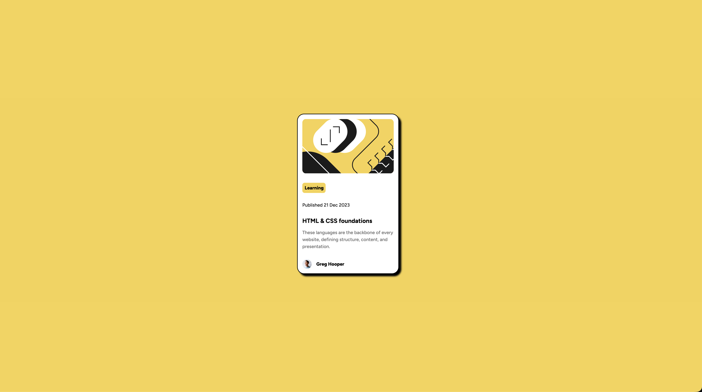

# Blog preview card

## Table of contents

- [Overview](#overview)
  - [Screenshot](#screenshot)

- [My process](#my-process)
  - [Built with](#built-with)
  - [What I learned](#what-i-learned)
  - [Continued development](#continued-development)
  - [Useful resources](#useful-resources)
  - [AI Collaboration](#ai-collaboration)
- [Author](#author)

## Overview

This is my solution to Frontend Mentor Blog preview card.

### Screenshot

## My process

### Built with

- Semantic HTML5 markup
- CSS3
- CSS custom properties
- Flexbox
- Google Fonts
- Mobile-first workflow

### What I learned

- How to use box-shadow to match a design.
- How to use the `:root` pseudo-class to reuse colors and spacing throughout the stylesheet.
- How to work with custom fonts and different font weights.
- How to create a responsive card layout.

### Continued development

- Improve my responsive design skills.
- Get better at choosing appropriate CSS properties.
- Practice creating more complex layouts from designs.
- Improve my understanding of typography and spacing.

### Useful resources

- [MDN Web Docs](https://developer.mozilla.org/en-US/docs/Web/CSS/Reference/Selectors/:root) - This is an amazing article which helped me learn :root CSS pseudo-class . I'd recommend it to anyone still learning this concept.

### AI Collaboration

I used Claude to understand the `box-shadow` property for this project.

## Author

- GitHub - [Piyush Kaushik](https://github.com/piyush-kaushik24)
- Frontend Mentor - [@piyush-kaushik24](https://www.frontendmentor.io/profile/piyush-kaushik24)
